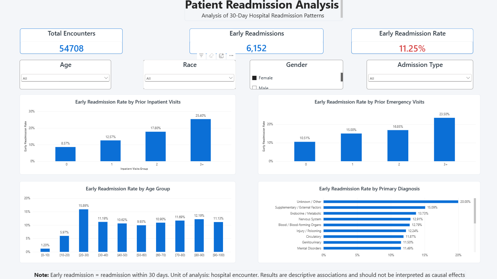
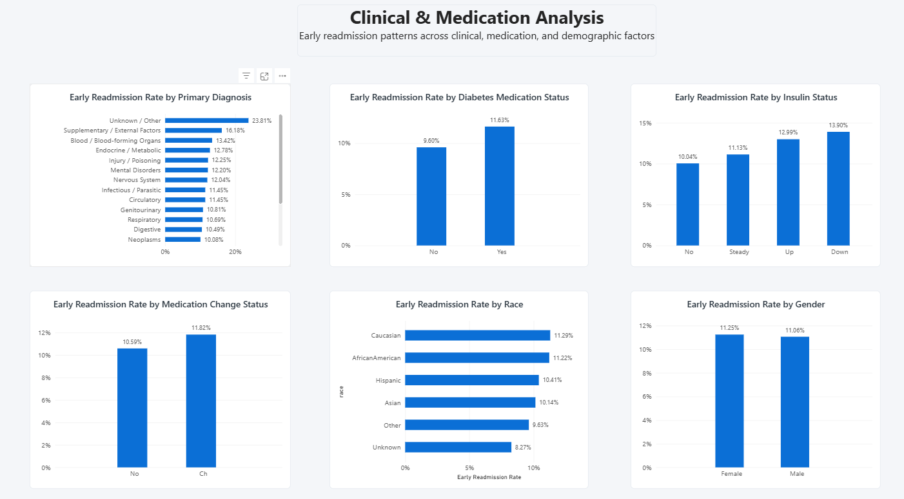
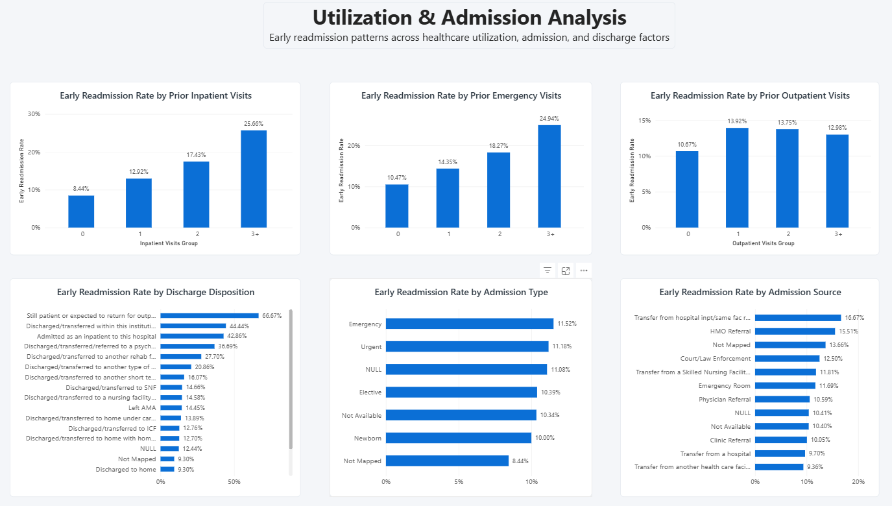

# Patient Readmission Analysis (Python • MySQL • Power BI)

[](#)
[](#)
[](#)

An end-to-end healthcare data analytics project investigating clinical, demographic, and operational factors associated with **30-day hospital readmissions** among diabetic patients. Built using **Python** for data cleaning and exploratory analysis, **MySQL** for relational querying and cohort aggregation, and **Power BI** (`projectk.pbix`) for interactive executive reporting.

---

## About the Project

Hospital readmissions increase healthcare costs and place substantial strain on inpatient capacity and clinical resources. In this project, I analyzed **101,766 inpatient encounters** involving diabetic patients to evaluate:

* **Baseline Readmission Burden:** How prevalent `<30-day` readmissions (`11,357` encounters; `11.16%`) are across the full hospital cohort.
* **Prior Utilization Impact:** How prior inpatient (`0`, `1`, `2`, `3+`), emergency (`0`, `1`, `2`, `3+`), and outpatient (`0`, `1`, `2`, `3+`) visits correlate with early readmission rates.
* **Demographic Disparities:** How 30-day readmission rates vary across **age brackets**, **race**, and **gender**.
* **Clinical & Medication Factors:** How primary diagnosis categories, diabetes medication prescriptions, insulin adjustments (`No`, `Steady`, `Up`, `Down`), and medication changes relate to readmission.
* **Care-Transition Characteristics:** How admission types, admission sources, and discharge dispositions differ across readmitted vs. non-readmitted encounters.

> **Methodological Note:** Unit of analysis is a hospital encounter (`101,766` total encounters). Because this study uses retrospective observational hospital records, findings represent descriptive statistical associations rather than causal effects.

---

## Dataset Overview

* **Source:** Diabetes 130-US Hospitals for Years 1999–2008 (UCI Machine Learning Repository)
* **Scale:** **101,766 hospital encounters** across 130 U.S. hospitals over a 10-year period.
* **Granularity:** Each row represents an individual **hospital encounter** (`encounter_id`), not necessarily a unique patient (`patient_nbr`), as individual patients may have multiple admissions across the study window.

---

## Target Variable Engineering

The raw `readmitted` field categorizes encounters into three outcomes:
* `NO` — No recorded readmission
* `>30` — Readmitted more than 30 days after discharge
* `<30` — Readmitted within 30 days of discharge

To align with standard hospital quality benchmarks (such as CMS 30-day readmission metrics), I engineered a binary target flag:
* **`early_readmission`**: Coded as `1` when `readmitted == '<30'` (**11,357** encounters) and `0` otherwise (`'>30'` or `'NO'`).

---

## End-to-End Analytics Workflow

### 1. Data Cleaning & Preprocessing (Python)
* Audited missing values (`?` placeholders across fields such as `race`, `weight`, `payer_code`, and `medical_specialty`) and standardized categorical labels (`NULL`, `Not Available`, `Not Mapped`).
* Engineered the binary `early_readmission` target flag, grouped ICD-9 diagnosis codes into clinical categories (e.g., *Circulatory*, *Endocrine / Metabolic*, *Nervous System*, *Infectious / Parasitic*), and bucketed visit counts (`0`, `1`, `2`, `3+`).

### 2. SQL Cohort & Driver Analysis (MySQL)
* Loaded the cleaned encounter table into **MySQL** to perform structured cohort aggregations across demographics, prior utilization (`number_inpatient`, `number_emergency`, `number_outpatient`), and clinical complexity.
* Computed segmented 30-day readmission rates (`SUM(early_readmission) / COUNT(*)`) using `GROUP BY` and `CASE WHEN` risk bucketing to evaluate high-risk admission and discharge pathways.

### 3. Interactive BI Reporting (Power BI — `projectk.pbix`)
Built a 3-page interactive dashboard in **Power BI Desktop** with dynamic slicers (**Age**, **Race**, **Gender**, **Admission Type**) and explicit **DAX** measures (`Total Encounters`, `Early Readmissions`, `Early Readmission Rate`):
* **Page 1 — Patient Readmission Analysis (Executive Overview):** Top-line KPI cards (`101,766` encounters, `11,357` early readmissions, `11.16%` early readmission rate), global slicers, and breakdowns by prior inpatient visits, prior emergency visits, age group, and primary diagnosis.
* **Page 2 — Clinical & Medication Analysis:** Early readmission comparison across primary diagnosis categories, diabetes medication status, insulin dosage changes, medication change status, race, and gender.
* **Page 3 — Utilization & Admission Analysis:** Detailed breakdown across prior inpatient, emergency, and outpatient visit groups alongside discharge disposition, admission type, and admission source.

---

## Key Insights & Takeaways

* **Baseline 30-Day Readmission Rate:** Out of **101,766** total hospital encounters, **11,357 (11.16%)** resulted in an early readmission within 30 days.
* **Strongest Utilization Drivers (Inpatient & Emergency History):** Early readmission rates scale sharply with prior hospital utilization—rising from **8.44%** (`0` prior inpatient visits) to **25.66%** (`3+` prior inpatient visits), and from **10.47%** (`0` prior emergency visits) to **24.94%** (`3+` prior emergency visits).
* **Medication & Insulin Adjustments:** Encounters where diabetes medications were prescribed (**11.63%** vs. **9.60%** without medication) or modified (`Ch`: **11.82%** vs. `No`: **10.59%**) showed higher readmission rates—most notably when insulin dosage was adjusted downward (**13.90%**) or upward (**12.99%**) compared to no insulin (**10.04%**).
* **Age Cohort Patterns:** Among adult cohorts, early readmission peaked in the **[20–30)** age bracket (**14.24%**) and remained elevated among older adults aged **[80–90)** (**12.08%**) and **[70–80)** (**11.77%**), compared to pediatric cohorts (**1.86%** for `[0–10)`).
* **Demographic & Admission Patterns:** Early readmission rates remained relatively consistent across gender (**11.25%** Female vs. **11.06%** Male) and major racial groups (**11.29%** Caucasian, **11.22%** AfricanAmerican), while **Emergency** admissions (**11.52%**) and transfers from inpatient/SNF facilities showed higher rates than **Elective** admissions (**10.39%**).

---

## Dashboard Preview

### 1. Executive Overview — Patient Readmission Analysis


### 2. Clinical & Medication Analysis


### 3. Utilization & Admission Analysis


---

## Repository Structure

```text
Patient_Readmission_Analysis/
├── dashboard_images/
│   ├── overview.png                 # Page 1: Executive KPIs & high-level drivers
│   ├── clinical_medication.png      # Page 2: Diagnosis, medication & demographic analysis
│   └── utilization_admission.png    # Page 3: Utilization, admission & discharge analysis
├── projectk.pbix                    # Power BI Desktop dashboard file
└── README.md                        # Project documentation
```

---

## How to Explore the Dashboard

1. Clone this repository or download `projectk.pbix`:
   ```bash
   git clone [https://github.com/AlupanaBalajiReddy/Patient_Readmission_Analysis.git](https://github.com/AlupanaBalajiReddy/Patient_Readmission_Analysis.git)
   ```
2. Open `projectk.pbix` in **Microsoft Power BI Desktop**.
3. Use the interactive slicers (**Age**, **Race**, **Gender**, **Admission Type**) to dynamically filter readmission metrics across all visuals.

---

## Author

**Alupana Balaji Reddy**  
[GitHub](https://github.com/AlupanaBalajiReddy)